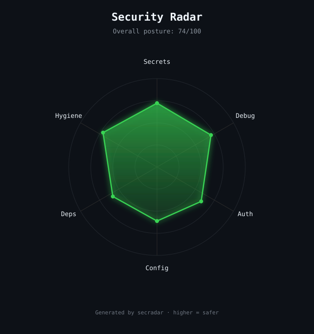

# secradar

> See your project's security posture as a radar.  
> One command. Pure SVG. Embeddable. Local.

<div align="center">



**Most tools give you a list. secradar gives you a picture.**

```bash
npx secradar
```

[](LICENSE)
[](https://nodejs.org/)
[](https://github.com/ilyasaalmadani/secradar/stargazers)

</div>

---

## Why secradar?

Security findings are usually walls of text.  
**secradar** turns the same class of risks into a single, shareable radar chart.

- **Secrets** — hardcoded keys and tokens
- **Debug** — leftover logs and debuggers that can leak data
- **Auth** — unprotected-looking admin or internal routes
- **Config** — .env and gitignore hygiene
- **Deps** — risky dependency patterns
- **Hygiene** — overall density of the above

Higher on the radar = safer. The SVG is self-contained, so you can drop it into a README, Slack, or a PR description.

## Quick start

```bash
npx secradar
# writes security-radar.svg in the current directory

npx secradar ./my-app my-radar.svg
```

Then embed it:

```markdown

```

## What you get

- Pure SVG output (no server, no account, nothing leaves your machine)
- Overall posture score
- Six axes that surface the problems AI coding agents most often leave behind
- Dark, GitHub-friendly aesthetic with subtle glow

## Relationship to other tools

| Tool | Role |
|------|------|
| **secradar** | Visual radar of security posture (this repo) |
| **aiship** | Text readiness score + findings for AI-generated code |
| **SHIPSAFE** | Full local Mac scanner (148 checks) |

secradar is the open-source visual layer. It does not replace the deep scanner.

## Roadmap

- [x] Pure SVG radar chart
- [x] Multi-axis heuristics
- [ ] Custom axes via config
- [ ] JSON output
- [ ] GitHub Action
- [ ] Optional sweep animation

## Contributing

PRs welcome. Especially useful:

- Better detection rules per axis
- Additional visual themes
- Fixtures that show clear before/after radars

## License

MIT © [Ilyas Akbar Almadani](https://github.com/ilyasaalmadani)

---

<div align="center">

**Built for developers who want their security posture to be visible, not just listed.**

Star the repo if the radar is useful — it helps others find it.

</div>
